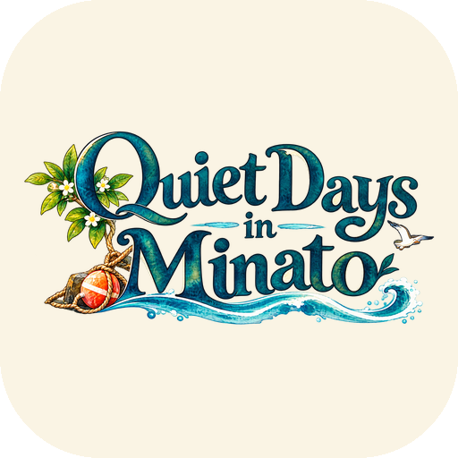

# Quiet Days in Minato

Cozy 3D farming & island-life game (Godot 4.7). Demo 7 hari.

## Download (Android)

**[Download APK terbaru](https://github.com/SangsakaWira/minato-quiet-days/releases/latest/download/Minato-Quiet-Days.apk)**

- Android 64-bit (arm64-v8a), ~153 MB
- Install: buka file APK, izinkan "Install dari sumber tidak dikenal" bila diminta.

Repo ini hanya untuk distribusi build; source code tidak disertakan.

## Kontrol di HP

- Joystick kiri: jalan · geser layar kanan: putar kamera
- **E**: interaksi (tahan saat menarik ikan) · **Tas** · **Benih**: ganti benih · **Atur**: tata letak kebun
- Sentuh slot hotbar untuk memilih alat · **II** / tombol Kembali: menu jeda · **X**: tutup menu
